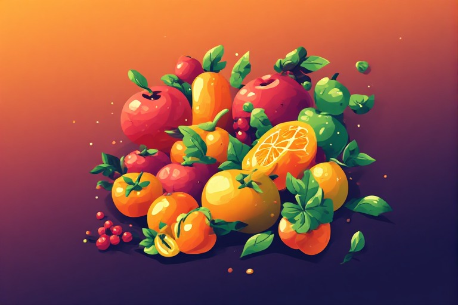
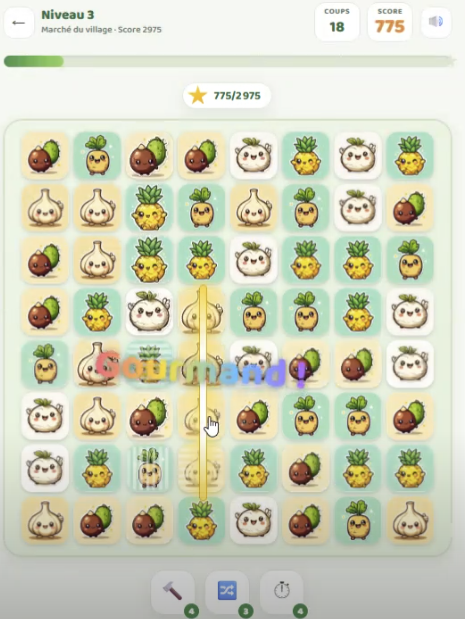

  
  <h1>fruits-legumes</h1>
  
<i>Découvrez quels fruits et légumes sont de saison et cultivés localement en Belgique, mois par mois. Calendrier interactif, fiches détaillées, bienfaits, conseils de préparation, et un jeu de match-3 e</i>

  
<b>Catégorie:</b> Art / Engine

  <a href="https://T2Smart-AI.github.io/perchance-fruits-legumes/">Live Demo</a> | <a href="showcase.html">Showcase</a>

## 🇫🇷 Français

### Description
Une application interactive dédiée à la saisonnalité des produits en Belgique. Explorez le calendrier agricole, apprenez-en plus sur la nutrition et testez vos connaissances avec un jeu de match-3.

### Contrôles & Interface
**Navigation :**
- **Écrans :** Accueil (`view-home`), Almanach (`view-almanach`), Calendrier (`view-calendrier`), Jeu (`view-jeu`), Local (`view-local`), et Overlay de détails.
- **Boutons :** En ce moment, Almanach, Calendrier, Le Jeu, Local, ←, →, ↵, ↻, Recommencer, ×.

### Détails Techniques
- **Technologies :** Canvas, i18n.
- **Moteur :** Physique custom, stockage via kv-plugin (IndexedDB).
- **Plugins :** ai-text-plugin, text-to-image-plugin, kv-plugin, upload-plugin.
- **Architecture :**
    - Core: `src/app.js`
    - Data: `local.js`, `avatars.js`, `products.js`, `banners.js`, `nutrition.js`, `levels.js`
    - AI Prompts: `src/tools/avatar-prompts.json`
- **Stats :** 321 fichiers, 23413.8KB.

## 🇬🇧 English

### Description
An interactive application dedicated to the seasonality of produce in Belgium. Explore the agricultural calendar, learn about nutrition, and test your skills with a match-3 game.

### Controls & Interface
**Navigation :**
- **Screens :** Home (`view-home`), Almanac (`view-almanach`), Calendar (`view-calendrier`), Game (`view-jeu`), Local (`view-local`), and detail overlay.
- **Buttons :** En ce moment, Almanach, Calendrier, Le Jeu, Local, ←, →, ↵, ↻, Recommencer, ×.

### Technical Details
- **Tech Stack :** Canvas, i18n.
- **Engine :** Custom physics, storage via kv-plugin (IndexedDB).
- **Plugins :** ai-text-plugin, text-to-image-plugin, kv-plugin, upload-plugin.
- **Architecture :**
    - Core: `src/app.js`
    - Data: `local.js`, `avatars.js`, `products.js`, `banners.js`, `nutrition.js`, `levels.js`
    - AI Prompts: `src/tools/avatar-prompts.json`
- **Stats :** 321 files, 23413.8KB.

## 🖼️ Captures / Screenshots

## 🔄 Sync Notes
Tracking and synchronization between Perchance and the repository are managed via `notification.md`. Locked screenshots must not be regenerated by hand.

## 📄 License
MIT
