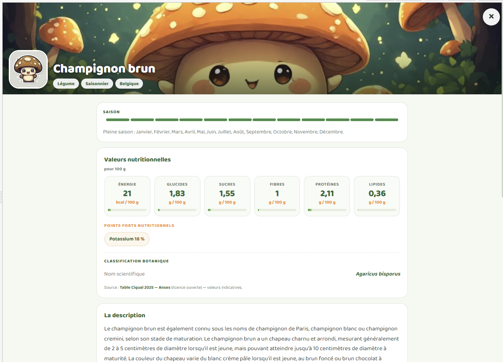
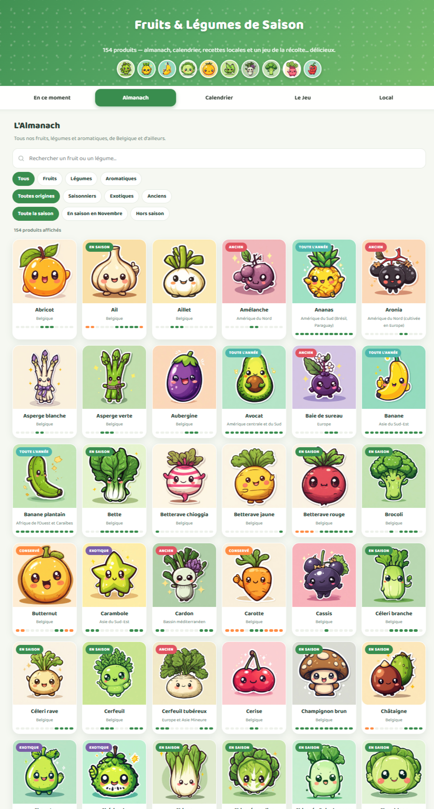

  
  <h1>Fruits &amp; Légumes de Saison</h1>
  
Apprendre en s'amusant

  
<b>Éducation</b>

  <a href="https://T2 스마트-AI.github.io/perchance-fruits-legumes/">Demo Live</a> | <a href="showcase.html">Showcase</a>

<a href="https://T2Smart-AI.github.io/perchance-fruits-legumes/">🚀 Live demo</a>

## 🇫🇷 Français

Découvrez quels fruits et légumes sont de saison et cultivés localement en Belgique, mois par mois. L'application propose un calendrier interactif, des fiches détaillées sur les bienfaits et conseils de préparation, ainsi qu'un jeu de match-3 éducatif.

### 🕹️ Commandes & Interface
**Écrans :**
- Accueil (`view-home`)
- L'Almanach (`view-almanach`)
- Le Calendrier (`view-calendrier`)
- Match des Saisons (`view-jeu`)
- Manger Local (`view-local`)
- Détails (`detailOverlay`)

**Boutons de navigation :**
- `En ce moment`, `Almanach`, `Calendrier`, `Le Jeu`, `Local`
- Navigation : `‹`, `›`, `←`, `🔄`
- Actions : `Recommencer`, `×`

### 🛠️ Technique
- **Moteur :** Canvas, i18n
- **Plugins :** AI Text, Text-to-Image, KV-Plugin (IndexedDB), Upload-Plugin
- **Physique :** Custom
- **Architecture :**
  - Core : `src/app.js`
  - Logique de jeu : `src/game.js`
  - Données : `products.js`, `local.js`, `avatars.js`, `banners.js`, `nutrition.js`, `levels.js`
  - Prompts AI : `src/tools/avatar-prompts.json`

---

## 🇬🇧 English

Discover which fruits and vegetables are in season and grown locally in Belgium, month by month. This app features an interactive calendar, detailed fact sheets including health benefits and preparation tips, and an educational match-3 game.

### 🕹️ Controls & Interface
**Screens :**
- Home (`view-home`)
- Almanac (`view-almanach`)
- Calendar (`view-calendrier`)
- Seasons Match (`view-jeu`)
- Eat Local (`view-local`)
- Details (`detailOverlay`)

**UI Buttons :**
- `En ce moment`, `Almanach`, `Calendrier`, `Le Jeu`, `Local`
- Navigation : `‹`, `›`, `←`, `🔄`
- Actions : `Recommencer` (Restart), `×` (Close)

### 🛠️ Tech Stack
- **Engine :** Canvas, i18n
- **Plugins :** AI Text, Text-to-Image, KV-Plugin (IndexedDB), Upload-Plugin
- **Physics :** Custom
- **Source Mapping :**
  - Core : `src/app.js`
  - Game Logic : `src/game.js`
  - Data : `products.js`, `local.js`, `avatars.js`, `banners.js`, `nutrition.js`, `levels.js`
  - AI Prompts : `src/tools/avatar-prompts.json`

---

## 🖼️ Captures / Screenshots

## 🔄 Sync Notes
This repository is tracked via `notification.md` for two-way synchronization between Perchance and GitHub. Locked screenshots must not be regenerated by hand to maintain version consistency.

## 📄 License
MIT
